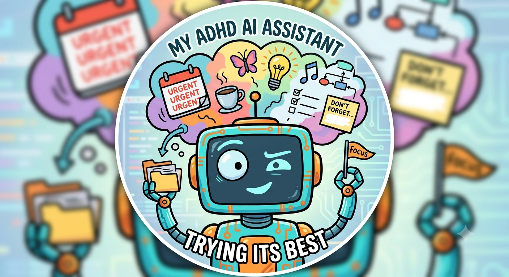
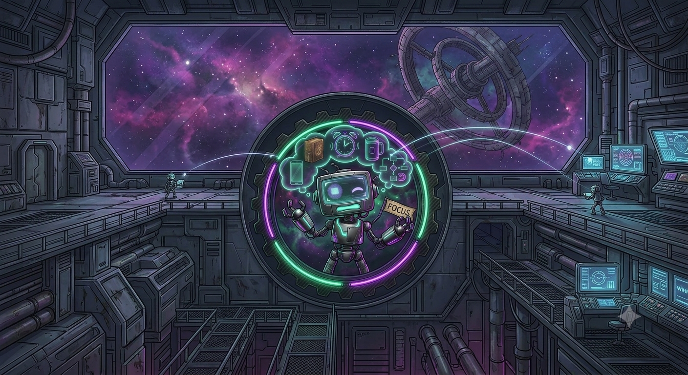

<p align="center">
  
</p>

<h1 align="center">Automated Digital Heuristic Daemon (A.D.H.D)</h1>

<p align="center"><strong>A fully-local operating system for the ADHD brain.</strong><br>
You talk, the system remembers — because one of you had to.</p>

<p align="center">
  <em>100% local · no cloud · no API keys · no subscriptions · your thoughts never leave your box</em>
</p>

---

## What is this?

You know that thing where you have a brilliant thought, and then a door closes somewhere, and now the thought is gone forever and also you're in the kitchen for some reason?

A.D.H.D is the fix. You mumble a voice memo at your phone; a pipeline of **local AI agents** transcribes it, figures out who and what you were talking about, files it into a structured [Obsidian](https://obsidian.md) vault, links it to everything related, and later taps you on the shoulder about the parts you were absolutely, definitely going to remember on your own.

It's object permanence, but for thoughts. An external hippocampus with a Docker socket.

This is a **cloud-free re-implementation** of the excellent [**AutoADHD** by Usman Kotwal (`uetzel/AutoADHD`)](https://github.com/uetzel/AutoADHD) — same vault model, same knowledge-zone structure, same 12-agent design. The original concept and architecture are his; this port swaps the entire runtime so it runs on hardware you own:

| Dimension | Upstream (`uetzel/AutoADHD`) | A.D.H.D (this repo) |
|---|---|---|
| LLM backbone | Claude API + CLI | **Local Ollama** via a custom tool-using harness (`ollama_agent.py`) |
| Transcription | Whisper (Apple Silicon) | **WhisperX large-v3** + pyannote diarization + voiceprint speaker-ID |
| Scheduling | macOS `launchd` | **`scheduler.py`** watcher — per-job timeouts, and mutating jobs serialized behind a vault lock |
| Interfaces | Telegram + Cowork + MCP | **Discord bot + Open WebUI chat + ntfy** pushes |
| Host | macOS workstation | **Any Docker host** (NAS, mini PC, home server) |
| Email sending | Gmail SMTP | **Draft-only, never sends.** The robot does not get your email password. |

## The pipeline (a thought's journey)

```
 you, walking to the car, talking to your phone
        │
        ▼
  voice memo ──Syncthing──▶ watcher ──▶ WhisperX transcribe + diarize + speaker-ID
        │
        ▼
  transcript correction ──▶ Extractor (chunked) ──▶ typed Canon notes with wikilinks
        │
        ▼
  Reviewer sanity-checks ──▶ archive audio ──▶ ntfy/Discord: "got it, here's what I heard"
```

Notes come out with typed frontmatter, an emoji header for visual scanning (ADHD eyes lock onto 👤 faster than onto YAML), and full provenance — which agent wrote it, when, from which memo. The raw transcript is **shell-owned and never rewritten by a model**: what you actually said stays the source of truth.

## The agents (a small, over-caffeinated staff)

Twelve specialists instead of one distractible generalist — we know better than to give one brain twelve jobs:

- **Extractor** — turns rambles into structured knowledge
- **Reviewer** — checks the Extractor's homework
- **Implementer** — self-heals broken links and formatting
- **Thinker / Mirror / Retrospective** — pattern-spotting and weekly reflection
- **Briefing** — the morning "here's what today actually is" note
- **Task-Enricher** — breaks "sort out the garage" into steps a human might actually start
- **Researcher** — synthesizes across your vault
- **Operator** — writes drafts to `Meta/operations/pending/` for **you** to read and copy-paste. It has no send path at all: no mail, calendar, Drive or Notion client exists in the code, wired or unwired. Want send capability? Follow [upstream `uetzel/AutoADHD`](https://github.com/uetzel/AutoADHD)'s guide to wire one in yourself
- **Advisor** — chat over your vault via Open WebUI, read-only except its own persistent-memory note
- **Orchestrator** — keeps the others on task; someone has to

Plus four janitors — two ported, two new here:

- **Manifest** (`build-manifest.sh`) — rebuilds the vault manifest. Ported from upstream.
- **Health** (`run-health.sh`) — hourly liveness/sanity check. Ported from upstream (`vault-health.sh` there).
- **Groomer** (`run-groomer.sh`) — Sunday tidy-up pass. **New in this port** — no upstream equivalent.
- **Dedup** (`run-dedup.sh`) — flags near-duplicate notes for review. **New in this port** — no upstream equivalent.

Full specs in [`Meta/Agents/`](Meta/Agents/), blueprint in [`Meta/Architecture.md`](Meta/Architecture.md).

## Quickstart

The dopamine-friendly version — three steps, visible progress at each one:

```bash
# 1. Clone (you've already done the hard part: starting)
git clone https://github.com/CatmeistersDev/Automated-Digital-Heuristic-Daemon && cd Automated-Digital-Heuristic-Daemon

# 2. Answer a few questions (Enter accepts the default; safe to re-run any time)
./setup.sh

# 3. Go
docker compose up -d --build
```

`setup.sh` asks for your name, timezone, Ollama address and model, a Hugging Face token (for
speaker labels) and any notification channels you want, then writes them to `.env` and
`.secrets/` — both git-ignored. It also downloads WhisperX into the build folder, generates
the Advisor token for Open WebUI, and copies the per-agent model template. Prefer doing it by
hand? Every value is a `${...}` in [`docker-compose.yml`](docker-compose.yml); put them in `.env`.

Then run `make check` (syntax + shellcheck + frontmatter gate) and `make health`. (`setup.sh` offers to install the git hook that blocks accidental deletions under `Canon/`; `make install-hooks` does the same.) Full operator guide with every knob: [`SYSTEM.md`](SYSTEM.md).

## Configuration

Everything is env vars in [`docker-compose.yml`](docker-compose.yml), filled from `.env` (which `./setup.sh` writes) — any hostnames or addresses in the docs are **placeholders**, swap in your own:

| Var | What | Default-ish |
|---|---|---|
| `OLLAMA_HOST` | your Ollama endpoint | `http://ollama:11434` |
| `OLLAMA_AGENT_MODEL` | the brain | whatever your GPU forgives |
| `NTFY_URL` / `NTFY_TOPIC` | ntfy push alerts | empty (disabled) / `autoadhd` |
| `TELEGRAM_BOT_TOKEN` / `TELEGRAM_CHAT_ID` | Telegram alerts; both required or the channel stays off | empty (disabled) |
| `VAULT_OWNER` | your name (agents address you) | — |
| `TZ` | your timezone — schedules and memo dates use local time | `UTC` |
| `VAULT_PATH` | host folder mounted as the vault | `.` (this repo's demo vault) |
| `WHISPER_MODEL` | transcription size | `large-v3` |
| `DISCORD_ALLOWED_USER_ID` | who may talk to the bot — access fails **closed**, so leaving it empty means the bot ignores everyone | empty |
| `DISCORD_ALLOW_ANYONE` | set to `1` to let **any** Discord user drive the bot (full vault read via the Advisor, plus `/done` writes). Leave unset. | unset |
| `ADVISOR_TOKEN` | **required** — the Advisor (chat endpoint, :8723) refuses to start without it unless bound to loopback; any random string, also set as Open WebUI's connection API key | — |
| `ADVISOR_HOST` | bind address for the Advisor; `127.0.0.1` skips the token requirement (co-located Open WebUI only) | `0.0.0.0` |

### Notifications — pick your own

Alerts fan out through [`Meta/scripts/notify.sh`](Meta/scripts/notify.sh) to three independent
channels. Configure any, all, or none: each is a no-op unless its own config is set, and nothing
else in the system changes based on which you choose.

| Channel | Alerts out | Interactive commands | Setup |
|---|---|---|---|
| **ntfy** | yes | no — push-only by design | [`docs/notifications/ntfy.md`](docs/notifications/ntfy.md) |
| **Discord** | yes | yes — `/ask` `/brief` `/actions` `/done` `/draft` `/focus` `/research`, plus voice-memo upload | [`docs/notifications/discord.md`](docs/notifications/discord.md) |
| **Telegram** | yes | not in this port — see the guide | [`docs/notifications/telegram.md`](docs/notifications/telegram.md) |

Failed sends never disappear silently: `notify.sh` can't alert about its own failure, so it appends
to `Meta/notify-errors.log` and `make health` surfaces recent entries.

**Android:** record with [Fossify Voice Recorder](https://github.com/FossifyOrg/Voice-Recorder) (free, open source, no setup beyond picking a save folder). Point its save folder at a Syncthing-shared folder that syncs to `Inbox/Voice/_drop/` on the vault host, and the watcher picks each memo up as it lands. Its m4a/mp3/ogg output is all accepted.

*Older option:* the Tasker profile ([`Tasker_Capture_v2.tsk.xml`](Tasker_Capture_v2.tsk.xml)) still works if you'd rather use Tasker. It was the original capture route and also writes GPS into the filename. It still goes through Syncthing → the watcher.

**iPhone:** build a Shortcut (ported from upstream `uetzel/AutoADHD`'s recipe) — **Record Audio** → **Get Current Location** → **Text**: `loc_[Latitude]_[Longitude]_[Current Date]` → **Save File**: File = Recording, Destination = `Inbox/Voice/_drop/`, Subpath = `[Text].m4a`. Turn off "Ask Where to Save," add the Shortcut to your home screen. Drop the file into `Inbox/Voice/_drop/` via iCloud sync or `scp`/sshfs to the vault host — anything that lands a file there works, since `scheduler.py`'s watcher (`VOICE_DROP_DIR`) picks it up the moment it appears, no manual trigger needed.

**Speaker ID starts empty.** Voiceprints are biometrics, so `Meta/voiceprints/` is git-ignored and this repo ships none — a clone inherits zero enrolled voices, and diarized memos label speakers `SPEAKER_00`/`SPEAKER_01` until you enroll someone with [`enroll-voice.sh`](Meta/scripts/enroll-voice.sh). Worked examples of the file format (synthetic, they match nothing): [`docs/examples/voiceprints/`](docs/examples/voiceprints/).

## Privacy (the whole point)

- Everything runs on your hardware. No API keys, no telemetry, no data leaving the box by default. The one exception: the Researcher agent can optionally query a local SearxNG instance (or a DuckDuckGo fallback) for external context on a human-chosen topic — every other agent, including the Extractor (which processes untrusted transcript text), has zero network tools and cannot reach the web.
- Secrets live in git-ignored `.secrets/` files. Voiceprints (biometric!) and audio are git-ignored too.
- **The Operator drafts; a human sends.** Its output is a file in `Meta/operations/pending/` stamped `executed: false`, and the way it reaches anyone is you opening it and copy-pasting. This is not a permission the system withholds — it is a capability that does not exist: `run-operator.sh` has no network client and no external-service credentials (`run-operator.sh:1-6`), and nothing downstream sends on its behalf. Trust is earned in increments, even for robots.
- The demo vault (`Canon/`, `Inbox/Voice/`, `Thinking/`) is a fictional seaside-restaurant scenario so you can see the note format before feeding it your actual brain.

## Roadmap

- [x] Hardened agent sandbox (default-deny shell allowlist, path-escape fixes)
- [x] Reproducible builds (`constraints.txt` pinning)
- [x] iOS Shortcut capture recipe
- [x] CI workflow running `make check` on push
- [x] Setup wizard (`./setup.sh`) so setup is mostly "press enter"
- [ ] More capture paths (email-in)

## Credits & license

Original concept, design, and 12-agent architecture by **Usman Kotwal** — [`uetzel/AutoADHD`](https://github.com/uetzel/AutoADHD). This local-stack port exists because his idea was too good to leave in the cloud. [MIT](LICENSE); upstream copyright preserved.

Built by one ADHD brain, for ADHD brains, with an AI assistant that is — like its author — trying its best.

<p align="center">
  
</p>
